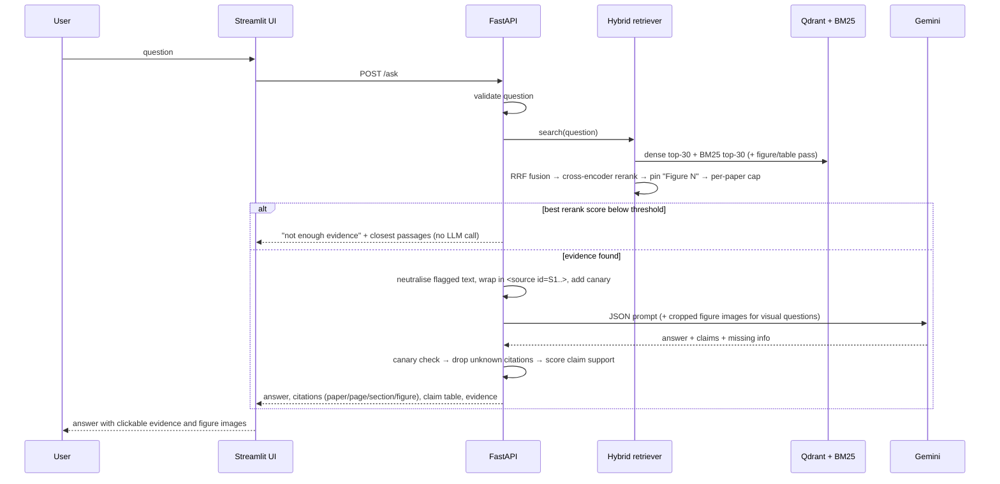

# Architecture

## Application flow

## 1. Parsing strategy (`data_ingestion/pdf_parser.py`)

* **Library:** PyMuPDF. It is fast, gives block bounding boxes, font size and bold flags, finds images,
  vector drawings and tables (`find_tables`), and renders any region to PNG. One library covers text,
  layout and cropping.
* **Reading order:** blocks are labelled left column, right column or full width by their x-position.
  Full-width blocks (title, wide figures) split the page into bands. Inside a band, the whole left column
  is read before the right column.
* **Noise removal:** short blocks repeated on at least half the pages (running headers/footers), bare page
  numbers and the vertical arXiv stamp are dropped.
* **Headings:** known section names (Abstract, Introduction, ..., Limitations), numbered bold headings
  (`3.2 Retrieval`), or text clearly bigger than the body font (median size of long paragraphs).
* **Missing text (OCR):** a page with under 40 characters of text is rendered at 300 DPI and read with
  Tesseract `image_to_data`. Word boxes become positioned blocks, split at headings, captions and font-size
  changes, so scanned pages go through the same reading-order, heading and figure logic. Low confidence → warning.
  No Tesseract → warning ("page 7 has no text layer…") instead of failing. Details: [`ocr.md`](ocr.md).
  A page that throws is skipped with a warning, so one bad page never stops a paper.

## 2. Figures and tables, and how they stay linked to their text

1. Captions are found with `^(Figure|Fig.) N[:.]` and `^Table N[:.]`. In-text mentions like
   "Figure 2 shows" don't match because they lack the colon/period.
2. **Figure region:** the union of raster images and vector drawings above the caption, in the same
   column, within 65% of the page height. It is cut off at the nearest long paragraph above. If no
   graphics are found, the empty gap above the caption is used.
3. **Table region:** the nearest `find_tables()` table next to the caption (converted to markdown).
   Otherwise, the area below the caption up to the next paragraph, heading or caption.
4. Region + caption are rendered at 2× to `data/figures/<paper>/<id>_p<page>.png`.
5. Short text blocks inside the region (axis labels, legend entries, node names, table cells) are moved
   out of body text into the figure's "labels". That keeps them out of normal chunks and makes them
   searchable on the figure.
6. Every sentence in the paper that mentions "Figure N" / "Table N" is attached to that element
   (`referenced_in`, with page). This is how a figure connects to the authors' written explanation.
7. Gemini Vision describes the crop as JSON (visual type, components/flow, axes/legend, key
   values/trends, legible yes/no). Results are cached by image hash.

Each figure/table becomes one **visual chunk**: caption + extracted table + labelled model description
+ nearby text + referencing sentences, with `paper_id`, `page`, `element_id` and the image path.

## 3. Chunking strategy (`data_ingestion/chunker.py`)

Semantic title-based chunking, the same idea as the Healthcare RAG app:

* A chunk never crosses a section heading, so each chunk stays on one topic and has an exact `§section`.
* Sections are split on sentence boundaries into chunks of up to 320 words, with 40 words of overlap.
  Tiny tails are merged into the previous chunk.
* Each chunk starts with `[paper title | section]`. BM25 and the embedding both "know" which paper and
  section the text belongs to. This is cheap contextual retrieval and helps a lot for "in LightRAG…"
  style questions.
* The References section is dropped. Appendix sections after it are kept.
* Metadata per chunk: `paper_id, paper_title, section, page_start, page_end, chunk_type
  (text|figure|table), element_id, figure_refs, injection_suspected`.

## 4. Indexing and metadata (`data_retrieval/store.py`)

* `chunks.jsonl`: the source of truth for text and metadata. It powers the evidence viewer and BM25.
* **Qdrant:** Qwen3-Embedding-0.6B vectors (queries use the model's `query` prompt), cosine distance,
  payload `paper_id`, `chunk_type` for filtering ("only these papers", "only figures").
* **BM25:** `rank_bm25` with a small stop-word list, rebuilt in memory when papers change.
* `papers.json`: catalogue metadata + ingestion stats + warnings for each processed paper.

## 5. Retrieval (`data_retrieval/hybrid_search.py`)

1. Dense top-30 and BM25 top-30 (with filters). For visual questions, an extra pass over figure/table
   chunks only.
2. Reciprocal Rank Fusion (k = 60). It needs no score calibration between BM25 and cosine.
3. The cross-encoder reranks the top 24.
4. Explicit "Figure/Table N of <paper>" references are pinned to the top. The paper is resolved by
   id, short name or alias.
5. At most 4 chunks per paper, final top-8.
6. If the best rerank score is below `MIN_RERANK_SCORE`, the question is answered as "insufficient
   evidence" without calling the LLM.

Questions that name two or more papers get extra per-paper retrieval so every named paper has evidence.
Comparison retrieves each aspect × paper separately. Synthesis is map (per paper) → reduce.

## 6. LLM layer (`backend/llm.py`, `backend/services.py`)

* Gemini via `google-genai`, JSON response mode, temperature 0.1.
* Three retries with exponential backoff. If the provider is down, `/ask` still returns the retrieved
  evidence with status `llm_unavailable`.
* Malformed JSON: tolerant parsing (fences, stray text), then one "repair" call, then a safe
  `malformed_output` status.
* Visual questions send up to 2 cropped figure/table images with the text sources, mapped to their
  source ids, so the model reads the actual chart and not only our pre-written description.
